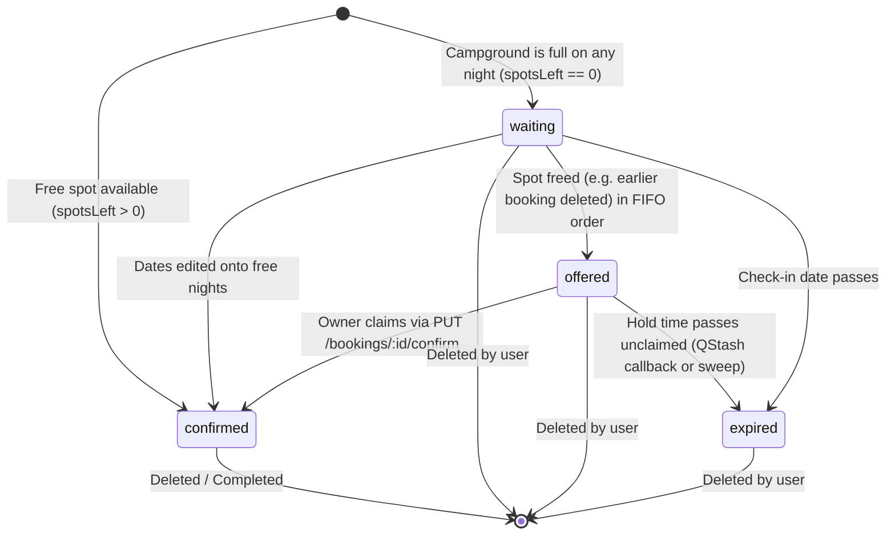

# Campground Booking REST API

[](https://expressjs.com/)
[](https://nodejs.org/)
[](https://www.mongodb.com/)
[](https://www.postman.com/)
[](LICENSE)

A robust, production-ready RESTful API for campground reservations and automated waitlist management, developed for the **2110503 Software Development Practice** term project at Chulalongkorn University.

Built with **Express 5** and **MongoDB (Mongoose)**, this service extends traditional accommodation booking systems with strict capacity tracking, back-to-back stay availability accounting, and a self-healing **FIFO Waitlist Engine** with automated email notifications.

---

## Table of Contents

- [Key Features](#key-features)
- [Booking & Waitlist State Machine](#booking--waitlist-state-machine)
- [System Architecture & Tech Stack](#system-architecture--tech-stack)
- [Project Directory Structure](#project-directory-structure)
- [API Endpoints Reference](#api-endpoints-reference)
- [Getting Started](#getting-started)
  - [Prerequisites](#prerequisites)
  - [Installation & Setup](#installation--setup)
  - [Environment Variables](#environment-variables)
  - [Running the Server](#running-the-server)
- [Testing](#testing)
  - [Manual QStash Check](#manual-qstash-check)
- [Security & Production Hardening](#security--production-hardening)
- [Contributors](#contributors)

---

## Key Features

- **Authentication & RBAC:**
  - Secure registration, login, and profile inspection (`/me`) with JWT stored in HTTP-only cookies and Bearer tokens.
  - Role-Based Access Control distinguishing standard `user` and elevated `admin` privileges.
  - 10-digit telephone regex validation (`^0[0-9]{9}$`).

- **Campground Management & Capacity:**
  - Full CRUD operations with integer capacity tracking ($\ge 1$).
  - Advanced MongoDB query filtering (`gt`, `gte`, `lt`, `lte`, `in`), field selection, sorting, and pagination.
  - Cascade deletion: Deleting a campground automatically cleans up all associated bookings.

- **Real-Time Availability Engine:**
  - Public `/campgrounds/:id/availability` endpoint calculating the minimum free spots across any night in the requested range.
  - Correctly handles **back-to-back stays** where check-in coincides with another booking's departure (`checkIn <= night < checkOut`).

- **Smart Booking Lifecycle & Waitlist:**
  - Stay constraint validation: 1 to 3 nights maximum, future check-in dates only (`>= todayUTC`).
  - Active booking limit: At most 3 active bookings per user (`confirmed`, `waiting`, or `offered` with future checkout; admins exempt).
  - **Zero-Failure Overbooking Prevention:** Booking a full campground places the booking into a `waiting` state (returns `201 Created` with a waitlist notice) rather than hard-failing with `400`.
  - **Automated Offer Engine (`offerFreeSpots`):** When a spot-holding booking is deleted or moved to other dates, or an admin raises capacity, the Waitlist is checked oldest first. The earliest queued booking fitting the opened nights is promoted to `offered`, holding the spot exclusively.
  - **Offer Claiming (`PUT /bookings/:id/confirm`):** Owner-exclusive claim endpoint to confirm an active offer before the deadline.
  - **Offer Expiry (Upstash QStash):** When an Offer is made, the server asks QStash to call `POST /bookings/:id/expire` once `OFFER_HOLD_MINUTES` has passed. An unclaimed Offer then expires and the Spot goes to the next waiting Booking. A sweep every 10 seconds catches missed callbacks and expires waiting Bookings whose check-in has passed.

- **Automated Email Notifications (Nodemailer):**
  - Instant dispatch when a waitlisted booking receives an offer.
  - Asynchronous, non-blocking fire-and-forget architecture with full error containment to prevent unhandled rejections.
  - Generates clickable [Ethereal Email](https://ethereal.email) preview URLs in development logs.

- **Security & Defensive Engineering:**
  - Protection against NoSQL Injection, XSS, HTTP Parameter Pollution (HPP), and DDoS (configurable rate limiting).

---

## Booking & Waitlist State Machine



| Status | Holds Spot? | Description |
| :--- | :---: | :--- |
| **`confirmed`** | **Yes** | Active reservation with a guaranteed spot at the campground. |
| **`waiting`** | **No** | Queued in the waitlist with a `queuedAt` timestamp. Counts toward the user's active 3-booking limit. |
| **`offered`** | **Yes** | Temporarily awarded a spot. Holds the spot exclusively until the claim deadline. |
| **`expired`** | **No** | The Offer wasn't claimed in time, or check-in passed while waiting. Stays in the owner's list until deleted, and doesn't count toward the 3-booking limit. |

---

## System Architecture & Tech Stack

```
                   +---------------------------------------------+
                   |             Client / Postman                |
                   +---------------------------------------------+
                                          |
                                    HTTP Requests
                                          v
+-------------------------------------------------------------------------------+
|                             Express 5 API Server                              |
|                                                                               |
|  [Security Middlewares]                                                       |
|  - Helmet (HTTP Headers)           - Mongo Sanitize (NoSQL Injection)         |
|  - XSS Clean (Sanitization)        - Express Rate Limit (DDoS Shield)         |
|  - HPP (Parameter Pollution)       - CORS (Cross-Origin Resource Sharing)     |
|                                                                               |
|  [Routers & Middlewares]                                                      |
|  - /api/v1/auth (auth.js)          - protect (JWT Authentication)             |
|  - /api/v1/campgrounds (campground)- authorize (Role Check: admin, user)      |
|  - /api/v1/bookings (booking.js)   - router.param('id') (ObjectID Guard)      |
|                                                                               |
|  [Controllers & Services]                                                     |
|  - auth.js                         - booking.js (CRUD + confirmBooking)       |
|  - campground.js (CRUD + avail)    - waitlist.js (offerFreeSpots)             |
|                                    - sendEmail.js (Nodemailer / Ethereal)     |
+-------------------------------------------------------------------------------+
                                          |
                                          v
+-------------------------------------------------------------------------------+
|                             MongoDB Atlas Cluster                             |
|  Collections: Users, Campgrounds, Bookings                                    |
+-------------------------------------------------------------------------------+
```

- **Backend Runtime:** Node.js (v20+)
- **Web Framework:** Express 5.x
- **Database / ODM:** MongoDB Atlas with Mongoose 9.x
- **Authentication:** JSON Web Tokens (`jsonwebtoken`) & `bcryptjs`
- **Email Delivery:** `nodemailer`
- **Security Middlewares:** `@exortek/express-mongo-sanitize`, `helmet`, `express-xss-sanitizer`, `express-rate-limit`, `hpp`, `cors`
- **Testing:** Postman / Newman

---

## Project Directory Structure

```text
Campground/
├── config/
│   ├── config.env.example        # Environment variable template
│   └── db.js                     # MongoDB connection setup
├── controllers/
│   ├── auth.js                   # Authentication & user profile logic
│   ├── booking.js                # Booking CRUD & offer confirmation
│   └── campground.js             # Campground CRUD & availability engine
├── middleware/
│   └── auth.js                   # Protect (JWT) & Authorize (RBAC) middlewares
├── models/
│   ├── Booking.js                # Booking schema & indexes
│   ├── Campground.js             # Campground schema with capacity & validation
│   └── User.js                   # User schema with bcrypt password hashing
├── postman/
│   ├── Campground.postman_collection.json  # Comprehensive automated test suite
│   └── Campground.postman_environment.json # Environment configuration
├── routes/
│   ├── auth.js                   # Auth routing (/api/v1/auth)
│   ├── booking.js                # Booking routing (/api/v1/bookings)
│   └── campground.js             # Campground routing (/api/v1/campgrounds)
├── utils/
│   ├── booking.js                # Shared date helpers & spotsLeft calculator
│   ├── sendEmail.js              # SMTP transporter & offer email dispatch
│   └── waitlist.js               # FIFO waitlist queue & offer distribution
├── package.json
└── server.js                     # Application entry point & middleware stack
```

---

## API Endpoints Reference

### **Authentication (`/api/v1/auth`)**
| Method | Endpoint | Access | Description |
| :--- | :--- | :--- | :--- |
| `POST` | `/api/v1/auth/register` | Public | Register a new user (`name`, `email`, `password`, `telephone`, `role`). |
| `POST` | `/api/v1/auth/login` | Public | Authenticate user and receive JWT cookie & token. |
| `GET` | `/api/v1/auth/me` | Private | Retrieve profile of the currently logged-in user. |
| `GET` | `/api/v1/auth/logout` | Public | Log out user and clear authorization cookie. |

### **Campgrounds (`/api/v1/campgrounds`)**
| Method | Endpoint | Access | Description |
| :--- | :--- | :--- | :--- |
| `GET` | `/api/v1/campgrounds` | Public | List campgrounds with pagination, filter, select, and sort. |
| `GET` | `/api/v1/campgrounds/:id` | Public | Retrieve detailed information for a single campground. |
| `POST` | `/api/v1/campgrounds` | Admin | Create a new campground with capacity. |
| `PUT` | `/api/v1/campgrounds/:id` | Admin | Update campground attributes or capacity. Raising capacity offers the new spots to the Waitlist. |
| `DELETE`| `/api/v1/campgrounds/:id` | Admin | Delete campground and cascade-delete its bookings. |
| `GET` | `/api/v1/campgrounds/:id/availability` | Public | Check availability for given `checkInDate` and `checkOutDate`. |

### **Bookings (`/api/v1/bookings`)**
| Method | Endpoint | Access | Description |
| :--- | :--- | :--- | :--- |
| `GET` | `/api/v1/bookings` | Private | View own bookings (User) or view all bookings (Admin). |
| `GET` | `/api/v1/campgrounds/:campgroundId/bookings` | Private | View bookings filtered by campground. |
| `GET` | `/api/v1/bookings/:id` | Private | View a single booking (Owner or Admin). |
| `POST`| `/api/v1/campgrounds/:campgroundId/bookings` | Private | Create booking (`confirmed` if open, `waiting` if full). |
| `PUT` | `/api/v1/bookings/:id` | Private | Reschedule stay dates (Owner or Admin). Freed nights go to the Waitlist. A `waiting` booking is confirmed if its new nights are free, otherwise it goes to the back of the Waitlist. `offered` and `expired` bookings return `400`. |
| `DELETE`| `/api/v1/bookings/:id` | Private | Cancel booking; triggers `offerFreeSpots` to waitlist. |
| `PUT` | `/api/v1/bookings/:id/confirm` | Private | Owner-only confirmation to claim an `offered` spot before its claim deadline. |
| `POST` | `/api/v1/bookings/:id/expire` | QStash | Signed QStash callback (no login, `401` without a valid `Upstash-Signature`). Expires an unclaimed `offered` booking and offers the Spot to the next in line. |

---

## Getting Started

### Prerequisites

- [Node.js](https://nodejs.org/) (v20.x or later recommended)
- [MongoDB](https://www.mongodb.com/) (Local instance or MongoDB Atlas cluster URI)
- Git

### Installation & Setup

1. **Clone the repository:**
   ```bash
   git clone https://github.com/pedigree-pp/Campground.git
   cd Campground
   ```

2. **Install dependencies:**
   ```bash
   npm install
   ```

3. **Configure environment variables:**
   Copy the example environment configuration:
   ```bash
   cp config/config.env.example config/config.env
   ```

### Environment Variables

Edit `config/config.env` with your preferred settings:

```env
PORT=5000
NODE_ENV=development

# Database connection
MONGO_URI=mongodb+srv://<user>:<password>@<cluster-host>/<database>?retryWrites=true&w=majority

# JWT Authentication
JWT_SECRET=your_super_secret_jwt_key
JWT_EXPIRE=30d
JWT_COOKIE_EXPIRE=30

# Rate Limiting
RATE_LIMIT_MAX=1000

# Waitlist Hold Duration (minutes; fractions work, 0.25 is 15 seconds)
OFFER_HOLD_MINUTES=1440

# Offer expiry through Upstash QStash (leave QSTASH_TOKEN empty to let the sweep expire Offers by itself)
QSTASH_TOKEN=
QSTASH_URL=
QSTASH_CURRENT_SIGNING_KEY=
PUBLIC_URL=

# Email Delivery (Ethereal test inbox)
SMTP_HOST=smtp.ethereal.email
SMTP_PORT=587
SMTP_USER=your_ethereal_user
SMTP_PASSWORD=your_ethereal_password
FROM_NAME=Campground
FROM_EMAIL=noreply@campground.test
```

> **Tip:** You can obtain free instant SMTP credentials at [Ethereal Email](https://ethereal.email/create).

### Running the Server

- **Development mode (with nodemon):**
  ```bash
  npm run dev
  ```
- **Production mode:**
  ```bash
  npm start
  ```

Once running, the server is available at `http://localhost:5000`.

---

## Testing

The project includes an end-to-end automated testing suite executed via **Newman**:

```bash
npm test
```

For the presentation, run only the **Demo** folder. It follows the presentation guide's steps 1–12 in order (user register, log in, view campgrounds, book with invalid cases, view, edit and delete own bookings, log out, then admin log in, view, edit and delete any booking). Each request name starts with its step number. It adds its own campground and removes it at the end.

```bash
npm run demo
```

### What the Test Suite Verifies:
- **Demo:** The presentation steps 1–12, in order.
- **Authentication & Security:** Registration, token issuance, password security, NoSQL injection prevention, XSS stripping, and Helmet response headers.
- **Campgrounds:** CRUD operations, filter parsing (`gt`/`gte`), field projections, integer capacity enforcement, and cascade deletion.
- **Availability:** Open campgrounds, fully-booked campgrounds (`spotsLeft = 0`), and back-to-back booking edges.
- **Bookings:** 3-night maximum enforcement, past date rejections, user 3-booking caps, owner permissions (`403` guards), and parameter casting (`404` guards).
- **Waitlist Lifecycle:** Full end-to-end test flow:
  1. User A books capacity-1 campground $\rightarrow$ `confirmed`.
  2. User B books same dates $\rightarrow$ `waiting` (201).
  3. User A deletes booking $\rightarrow$ User B promoted to `offered`.
  4. User C attempting to confirm gets `403`.
  5. User B confirms $\rightarrow$ `confirmed`.
- **Waitlist Edits:** Moving a confirmed booking gives the waiting booking an Offer. Editing an `offered` or `expired` booking returns `400`. A waiting booking edited onto full nights stays `waiting` with a new `queuedAt`, and one edited onto free nights becomes `confirmed`. Raising capacity gives a waiting booking an Offer.
- **Offer Expiry:** The expire callback without a valid QStash signature returns `401` and leaves the Offer alone. An unclaimed Offer expires after the hold time, stays in its owner's list as `expired`, and the Spot passes to the next waiting Booking.

Run the server for `npm test` against a throwaway database with `OFFER_HOLD_MINUTES=0.25`, no `QSTASH_TOKEN` and a raised `RATE_LIMIT_MAX`. The Offer expiry folder waits 30 seconds for an Offer to expire.

### Manual QStash Check

Newman runs without QStash, because QStash can't reach a local server. To check Offer expiry through QStash itself, including the signature check against a real delivery:

1. In the [Upstash console](https://console.upstash.com/qstash), copy `QSTASH_URL`, `QSTASH_TOKEN` and `QSTASH_CURRENT_SIGNING_KEY`.
2. Start a tunnel to the server and copy the `https://` address it prints. The address is new every time it starts.
   ```bash
   winget install --id Cloudflare.cloudflared
   ```
   ```bash
   cloudflared tunnel --url http://localhost:5000
   ```
3. In `config/config.env`, set those three keys, `PUBLIC_URL` to the tunnel address (exactly, with no trailing slash), `OFFER_HOLD_MINUTES=0.25` and a raised `RATE_LIMIT_MAX`. Restart the server: nodemon doesn't reload on config changes.
4. Run the Offer expiry folder:
   ```bash
   npx newman run postman/Campground.postman_collection.json -e postman/Campground.postman_environment.json --folder "Offer expiry"
   ```
5. It passes when:
   - every assertion passes. With the token set, the sweep waits 5 minutes past the hold time, so User B's Offer expiring within 30 seconds can only be the QStash callback;
   - the server log has no `QStash publish for Booking … failed` lines;
   - the Upstash console's QStash logs show two messages delivered with status `200`.
6. Afterwards, empty `QSTASH_TOKEN` again and restart before running `npm test`. With the token set and no tunnel, callbacks can't arrive and the Offer expiry folder fails.

If it fails:
- **`401` in the Upstash logs:** the signature was rejected. `PUBLIC_URL` doesn't match the tunnel address exactly, or the signing key isn't the current one.
- **`QStash publish … failed` in the server log:** the token or `QSTASH_URL` is wrong.
- **`502` or a connection error in the Upstash logs:** the tunnel isn't reaching the server on port 5000.

---

## Security & Production Hardening

- **NoSQL Injection:** `@exortek/express-mongo-sanitize` sanitizes user inputs by stripping query operator keys (e.g. `$` and `.`).
- **XSS Protection:** `express-xss-sanitizer` cleans untrusted HTML tags from incoming request bodies and query parameters.
- **Security Headers:** `helmet` applies critical security headers (`X-Content-Type-Options`, `X-Frame-Options`, HSTS).
- **Parameter Pollution:** `hpp` protects against query parameter manipulation.
- **Rate Limiting:** `express-rate-limit` prevents brute-force login and API abuse (10-minute window).
- **Graceful Shutdown:** Handles unhandled promise rejections and clean database disconnects.

---

## Contributors

- **Pedigree** ([@pedigree-pp](https://github.com/pedigree-pp))
- **Phonlakrit Lookyee** ([@taofuuu](https://github.com/taofuuu))
